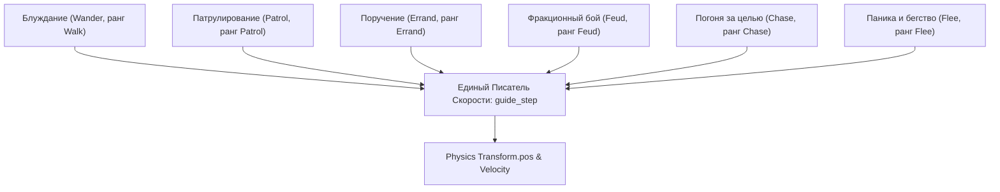

# 🧬 A-LIFE, MACRO-SIMULATION, NEEDS & SOCIAL SYSTEMS BIBLE — GIGAHRUSH 2

> **КАНОНИЧЕСКИЙ СТАНДАРТ СИМУЛЯЦИИ ЖИВОГО МИРА, МАКРОСИМА И СОЦИАЛЬНЫХ СИСТЕМ**  
> Сверено с актуальной кодовой базой C++23: `src/game/macro_sim.*`, `src/game/embody.*`, `src/game/needs.*`, `src/game/serve.*`, `src/game/guide.*`, `src/game/chronicle.*`.  
> Конституция: [THE_HAMMER_MASTER_PROMPT.md](THE_HAMMER_MASTER_PROMPT.md) | Архитектура: [CANONICAL_ARCHITECTURE.md](CANONICAL_ARCHITECTURE.md) | Канон: [CANON.md (S6, S7, S13, S21, S22, S24, S25)](../CANON.md)

---

## 1. МАКРОСИМУЛЯЦИЯ МИЛЛИОНА ЖИТЕЛЕЙ (`src/game/macro_sim.cpp`)

1. **Параллельный макромир ($2^{20}$ жителей):**
   - До $1\,048\,576$ жителей мегаструктуры живут параллельно в фоновой макросимуляции.
   - Житель вне зоны видимости игрока существует как компактная агрегированная структура данных:
     - `ResidentId` (уникальный ключ);
     - Фракция, социальный ранг, профессия;
     - Набор физиологических потребностей (голод, жажда, усталость);
     - Инвентарь (ключевые ресурсы, патроны, валюта);
     - Текущий этаж и домашняя комната.
2. **Грубые часы макросима (Coarse Clock, CANON S15):**
   - Макромир тикает не на 125 Гц, а на грубых дискретных интервалах времени (секунды/минуты).
   - В макросиме происходят фоновые миграции между этажами через лифты, торговля, потребление провизии, драки фракций и естественная смена поколений.
3. **Бесшовное контекстное воплощение (`src/game/embody.cpp`):**
   - Когда игрок входит на этаж, жители этажа **воплощаются** в активные сущности ECS EnTT (`emplace_mob`).
   - Воплощённый NPC получает физическое тело (7 сегментов `BodyPlan`), одометр походки `Gait`, AI мозг `AiBrain` и становится полноправным участником 125 Гц симуляции.
   - При уходе игрока с этажа (поездка на лифте) все физические сущности без потерь сжимаются обратно в макро-записи.

---

## 2. ЕДИНАЯ СИСТЕМА ДВИЖЕНИЯ И АРБИТРАЖ `SteerRank` (`src/game/guide.cpp`, CANON S25)

Исторический дефект множественных писателей скорости ликвидирован 2026-11-09:

1. **Один писатель скорости:**
   - Горизонтальная составляющая `Velocity` агентов пишется **строго одной системой** `guide_step`.
   - Любая подсистема поведения (AI, патруль, паника, драка) не имеет права напрямую мутировать координаты или скорость сущности.
2. **Арбитраж заявок руления (`Steer`):**
   - Каждая подсистема выставляет эфемерную заявку `Steer` на 1 тик с указанием целевой точки и ранга:
     $$\text{SteerRank::None} < \text{Walk} < \text{Chase} < \text{Feud} < \text{Errand} < \text{Patrol} < \text{Flee}$$
   - `guide_step` выбирает заявку с максимальным рангом за одно сравнение ($O(1)$). Порядок вызова систем в кадре больше не влияет на поведение.
   - Если тело охвачено паникой (`Flee`), заявка блуждания или патруля мгновенно и детерминированно подавляется.

---

## 3. ПОТРЕБНОСТИ И ВЫЖИВАНИЕ (`src/game/needs.cpp`, CANON S24)

1. **Динамика физиологических шкал:**
   - У каждого тела накапливаются 4 непрерывные шкалы потребностей:
     - `hunger` (голод) $\to$ требует еды (`IntentEat`);
     - `thirst` (жажда) $\to$ требует воды (`IntentDrink`);
     - `fatigue` (усталость) $\to$ требует сна (`IntentSleep`);
     - `pendingPee` / `pendingPoo` (давление выделений) $\to$ требует туалета (`IntentToilet`).
2. **Потоковое утоление нужд (`act_is_flow`):**
   - Утоление потребностей происходит не мгновенно (квантово), а непрерывным потоком на протяжении всего временного окна действия `Acting`.
   - Если процесс сна или питья прерывается уроном или шагом — шкала восстанавливается ровно на ту долю, сколько длился процесс (`acting_take_flow`).
3. **Физиологические выделения как материя:**
   - Процесс мочеиспускания (`relief_urine`) порождает реальные субвоксельные атомы материала `urine` в клеточный автомат мира (капает лужицей в окрестности 3³ клеток).
   - Тело оставляет реальные физические следы в мире, доступные для обнаружения монстрами по запаху и звуку.

---

## 4. ДЕЯНИЯ У ИНТЕРАКТОРОВ `Serve` (`src/game/serve.cpp`, CANON S22)

1. **Взаимодействие только прицелом на вещь:**
   - Деяния возможны только при наличии интерактора с компонентом `Serve`:
     - Койка, диван $\to$ сон и отдых;
     - Плита, стол $\to$ прием пищи;
     - Унитаз, раковина $\to$ гигиена и облегчение;
     - Верстак $\to$ крафт и ремонт.
2. **Окно действия `Acting`:**
   - При старте взаимодействия агент переходит в состояние `Acting`:
     - Блокируются посторонние команды;
     - Фаза окна $\phi \in [0.0, 1.0]$ передается в кинематику тела (`acting_phase_e3`), управляя процедурной позой (наклон к тарелке, лежание на койке);
     - При получении урона или внешнем толчке действие аварийно прерывается (`break_flow`).

---

## 5. ЛЕТОПИСЬ МИРА И ПАМЯТЬ СОБЫТИЙ (`src/game/chronicle.cpp`, CANON S21)

1. **Единая летопись событий (Chronicle):**
   - Любое значимое событие (убийство жителя, взрыв гранаты, разрушение стены, обвал здания, смена власти на этаже) регистрируется в кольцевом буфере Chronicle.
   - Запись несет временную метку (тик мира), тип события, координаты и идентификаторы акторов.
2. **Память агентов (`AiMemory`):**
   - Жители запоминают обидчиков (`MemFoe`), союзников (`MemAlly`), опасные места с монстрами и локации источников пищи и воды.
   - Обида (`grudge`) формируется из реального урона, зарегистрированного в Chronicle, порождая кровную месть между кланами без искусственных скриптов.
