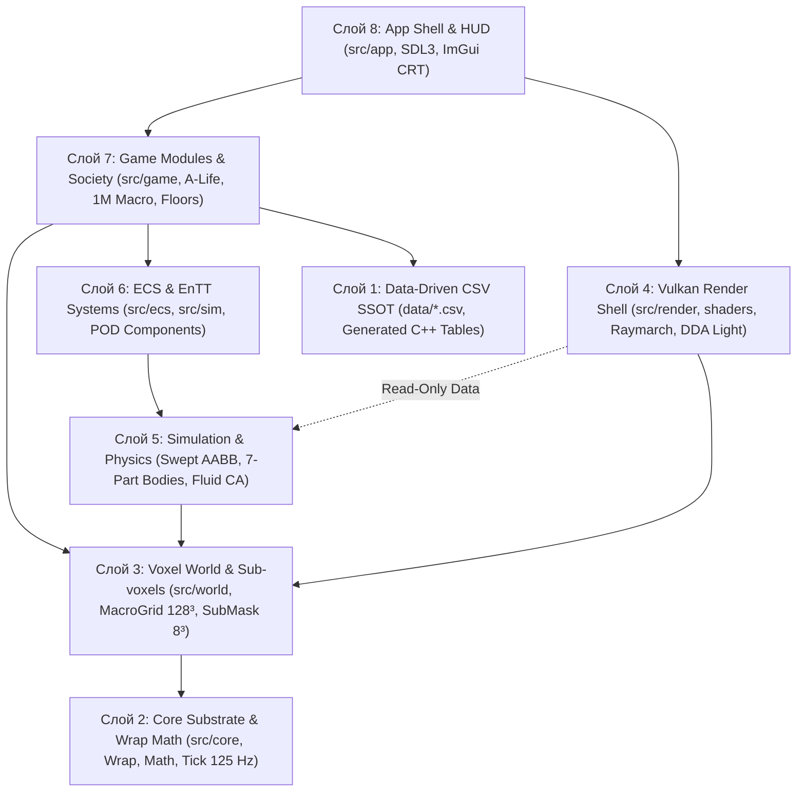

# 🏛️ CANONICAL ARCHITECTURE BIBLE — GIGAHRUSH 2

> **КАНОНИЧЕСКИЙ АРХИТЕКТУРНЫЙ СТАНДАРТ ДВИЖКА И СИМУЛЯЦИИ**  
> Сверено с актуальной кодовой базой C++23 / Vulkan (`C:\gigahrush2`).  
> Конституция: [THE_HAMMER_MASTER_PROMPT.md](THE_HAMMER_MASTER_PROMPT.md) | Навигация: [INDEX.md](INDEX.md) | Канон: [CANON.md](../CANON.md) | Кинематика и позы: [GAIT_AND_ACTIONS_DEEP_DIVE.md](GAIT_AND_ACTIONS_DEEP_DIVE.md)

---

## 1. СТРУКТУРНАЯ СЛОЁНАЯ АНАТОМИЯ ДВИЖКА

Архитектура GigaHrush 2 строго разделена на независимые, слабосвязанные слои. Поток данных и зависимостей направлен строго сверху вниз (от прикладных модулей к фундаментальному математическому ядру). Обратные зависимости запрещены компилятором и гейтом `source_rules`.

---

## 2. СЛОЙ 1: МАТЕМАТИЧЕСКИЙ СУБСТРАТ И ТОР (`src/core/`)

1. **Тороидальное 3D пространство (Toroidal Invariance):**
   - Мир представляет собой изотропный трёхмерный тор размером $128 \times 128 \times 128$ макроклеток.
   - Размер одной макроклетки $kCellSize = 2.0$ метра. Общий линейный размер тора $kWorldExtent = 256.0$ метров по осям X, Y, Z.
   - Координаты по всем трём осям непрерывно заворачиваются:
     - Макро-координаты: `wrapi(x, kGridDim)` нормализует индекс клетки в диапазон $[0, 127]$.
     - Мировые координаты: `wrap_macro(val)` нормализует положение в метрах в диапазон $[0.0, 256.0)$.
     - Тороидальная дельта расстояний: `wrap_delta(a, b, extent)` вычисляет кратчайший вектор между двумя точками на торе в интервале $[-extent/2, extent/2]$.
2. **Изотропия осей (All Axes Equal):**
   - Оси X, Y, Z абсолютно равноправны. В коде запрещены жесткие литералы направления вниз (`{0, 0, -1}` или `z - 1`).
   - Направление «вниз» определяется активным гравитационным фреймом `GravityRegime` (`NegZ`, `PosZ`, `NegX`, `PosX`, `NegY`, `PosY` и диагонали). Вся физика, движение и поиск опоры используют вектор `regime_down(regime)`.
3. **Фиксированный такт симуляции 125 Гц (`src/core/tick.h`):**
   - Константа симуляции `kSimHz = 125.0f`, фиксированный шаг времени $dt = 1.0 / 125.0 = 0.008$ с (8 миллисекунд).
   - Внутреннее время симуляции измеряется строго в тиках (`Tick`), а не в секундах или кадрах дисплея.
   - Игровой цикл использует аккумулятор времени `simAccum`: рендер может идти с любой переменной частотой кадров (60, 144, 240 FPS), но симуляция всегда делает целочисленное число фиксированных шагов по 8 мс.

---

## 3. СЛОЙ 2: ВОКСЕЛЬНЫЙ МИР И СУБВОКСЕЛЬНЫЕ АТОМЫ (`src/world/`)

1. **Два масштаба мира (Macro vs Micro):**
   - **Макро-масштаб (128³ клеток по 2.0 м):** Каркас для пространственного ускорения, грубой навигации, зонирования комнат, биннинга источников света и постраничной аллокации.
   - **Микро-масштаб (Субвоксели 0.25 м, 8³ = 512 штук на клетку):** Истинная физическая геометрия мира. Пули, зрение, трассировка лучей, точки опоры ног, динамический скол и коллизии оперируют исключительно субвокселями.
2. **Битовая упаковка субмасок (`SubMask`):**
   - 512 субвокселей одной макроклетки упакованы в плотный битовый массив: $512 \text{ бит} = 8 \times \text{uint64\_t}$ (`kSubMaskWords = 8`).
   - Бит `1` означает заполненный твердый воксель, бит `0` — воздух.
   - Запрос коллизии по субмаске выполняется побитовыми операциями `AND` / `OR`, что делает проверку полуразрушенной и монолитной клетки одинаково мгновенной (O(1)).
3. **Закон правды об атомах (Material First):**
   - Истина о материи — это `MaterialId` субвокселя (`data/materials.csv`). Воздух — это `material = 0`.
   - Битовая маска твердости — это быстрый кэш над материалом. Тип клетки (`CellType`) — это макро-кэш над маской. Локальные физические системы никогда не делают вывод о физике на основе типа клетки.
4. **Универсальный селектор поверхностей (`surface_face_at`):**
   - Любое крепление объектов, прокладка кабелей, посев мебели и ламп выполняется через единый примитив запроса субвоксельных граней по 6 направлениям $(\pm X, \pm Y, \pm Z)$.

---

## 4. СЛОЙ 3: ДВУХУРОВНЕВАЯ ФИЗИКА (CPU VS GPU) (`src/sim/`)

Разделение физических сущностей строго подчинено закону «дорого/дёшево»:

| Контур | Подсистема | Вычислитель | Объекты | Взаимодействие с миром |
|:---|:---|:---|:---|:---|
| **Тяжелый / Игровой** | `physics_step` | **CPU** | Тела жителей, мобов, игрока, трупы, тяжелые ящики (`RagdollRoll`, `SimpleFall`). | Двустороннее: толкают мир, сталкиваются между собой, наносят урон, открывают двери. |
| **Массовый / Антураж** | `VerletPass` | **GPU** (Compute) | Тысячи узлов проводов, тентов, провисших кабелей, миллионы осколков и искр. | Одностороннее: мир деформирует и рвет их, они на игровой мир не влияют («бесплатные»). |
| **Среда / Автомат** | `GpuMediumPass` | **GPU** (Compute) | Жидкости (вода, моча, кровь), газы, сыпучка на базе клеточного автомата Марголюса. | Клеточный обмен материей, конденсация в субвоксели, испарение. |

1. **CPU Swept AABB и капсулы тел:**
   - Движение сущностей использует непрерывное обнаружение столкновений (Continuous Collision Detection) через Swept-AABB против воксельной сетки. Запрещено телепортирование сквозь тонкие стены.
2. **7-сегментная модель тел и сочленений (CANON S28, `src/game/body_pose.*`, `src/sim/rigid.cpp`):**
   - Любое тело состоит из 7 канонических сегментов: таз, торс, голова, две руки, две ноги (`FormRole`).
   - Шарниры между частями соединены уравнениями связи «точка-в-точку» `JointLink`.
   - **Стабилизация Баумгарте без закачки энергии:** Солвер связей применяет расщепленный импульс — скорости решаются без подтяжки, а позиционная ошибка гасится позиционной проекцией `project_point_joint` (долей `kJointBias`) с геодезическим учетом тора `wrap_delta3`. Вращение гасится через `damp_point_joint` (`kSpinDamp`), а опора передается по сочленениям.
   - **Одометр и кинематика походки (`Gait`, `gait_step`, `form_gait_pose`):** Одометр накапливает путь стоп строго на опоре; угол размаха $\theta_{\max} \approx 17^\circ$ аналитически выведен из $kStepStrideOfHeight$ и длины ноги таблицы `prop_forms.csv`.
   - При смерти сущность расслабляется в физический рэгдолл, сохраняя непрерывность импульса каждого сегмента.
3. **GPU Verlet Интегратор (`verlet_sim.comp`):**
   - Единый унифицированный шейдер симуляции для одномерных цепей (провода), двумерных решеток (ткани, тенты) и точечных масс (частицы).

---

## 5. СЛОЙ 4: VULKAN РЕНДЕР И СВЕТОСЕТКА (`src/render/`)

1. **Pure Read-Only Shell (Принцип независимости рендера):**
   - Рендерер не владеет состоянием игры. Данные текущего тика собираются во фронт-буферы и передаются на GPU через `VulkanDevice` и дескрипторные сеты.
   - Любой запрос игровой логики (видимость цели, дальность выстрела) выполняется в симуляции через CPU-лучи по субмаскам, а не чтением буфера глубины.
2. **Реймаршинг тора (`raymarch.frag`):**
   - Первичный проход рендера выполняет DDA-маршинг луча через тороидальную воксельную сетку.
   - Сначала луч шагает по макро-клеткам 2.0 м; при пересечении непустой клетки луч спускается в DDA по 8³ субвокселям.
   - Туман всегда затухает в абсолютный черный цвет (`#000000`) на дистанции $kWorldExtent / 2 = 128.0$ м, что гарантирует полную бесшовность тороидального горизонта без визуальных стыков.
3. **Светосетка и запекание видимости (`GpuLightGrid`):**
   - Плотная 3D сетка освещения хранит сжатые списки видимых точечных источников и светоматериалов.
   - При входе на этаж воркер выполняет бейк видимости: 9 субвоксельных лучей с дилатацией для исключения просачивания света сквозь стены.
4. **Рендер многочастных тел и инвариант шва (`src/render/body_pass.cpp`):**
   - Живые тела рисуются частями своего плана (`BodyParts`), записанными в `body_parts_step`.
   - **Тороидальный образ ОДИН на тело:** Сдвиг `nearest_image` вычисляется для центра тела и транслируется всем частям, исключая разрыв сетки на шве тора.
   - **Ориентация сфер наружу (`build_unit_sphere`):** Обход 168 треугольников строго CCW наружу (коммит `6a46f7a`), предотвращающий отсечение лицевых граней при `VK_CULL_MODE_BACK_BIT` и почернение голов.
5. **Совет-панк эстетика служебной аппаратуры (ImGui CRT):**
   - Запрет скруглений: `WindowRounding = 0.0f`, `FrameRounding = 0.0f`.
   - Люминесцентный зеленый монохром (`#59F266`), янтарные предупреждения (`#F2C740`), полупрозрачный кинескопный фон (`#050A05` с альфой 0.88).

---

## 6. СЛОЙ 5: A-LIFE, МАКРОСИМУЛЯЦИЯ И ПОВЕДЕНИЕ (`src/game/`)

1. **Миллион жителей в макросиме (`macro_sim.cpp`):**
   - До $2^{20} \approx 1\,000\,000$ жителей живут параллельно в макро-масштабе в виде легковесных агрегированных записей (потребности, фракция, инвентарь, социальный статус).
   - На активном этаже жители в радиусе внимания игрока **воплощаются** (`embody.cpp`) в полноценные ECS-сущности с физическими телами и поведением. При уходе игрока сущности плавно сворачиваются обратно в макросим без потери данных.
2. **Utility AI и арбитраж руления (`guide.cpp`, CANON S25):**
   - Поведение NPC определяется 13 базовыми интентами через скоринг полезности с гистерезисом.
   - **Единый писатель движения:** Горизонтальная скорость тел управляется строго одной системой `guide_step`. Различные слои поведения лишь выставляют заявки `Steer` с рангом `SteerRank` (`Walk < Chase < Feud < Errand < Patrol < Flee`). Конфликты решаются одним сравнением рангов за $O(1)$.
3. **Физиологический цикл нужд (CANON S24) и деяния (`serve.cpp`, CANON S22):**
   - Тело накапливает жажду, голод, усталость, нужду в туалете.
   - Удовлетворение потребностей происходит через деяния `Serve` у специализированных интеракторов (койка, плита, унитаз, раковина) с честным временным окном `Acting` и расходованием ресурсов.
4. **Окно действий и позы глаголов (`src/game/action.h`, `acting_phase_e3`):**
   - Временное окно деяния генерирует пермилле-фазу $0..1000$ (`acting_phase_e3`), которая процедурно модулирует углы плеч, рук и корпуса для замахов, прицеливания и процедурных поз без запеченных клипов.

---

## 7. СЛОЙ 6: DATA-DRIVEN CSV КОНТЕНТНЫЙ КОНТУР (`data/`)

1. **CSV как единственный источник истины (Single Source of Truth):**
   - Любые игровые параметры хранятся в таблицах:
     - `data/items.csv` — предметы, вес, объем, слоты, износ, цены.
     - `data/mobs.csv` — виды мобов, базовые параметры, фракции, поведение.
     - `data/props.csv` — статическая и динамическая мебель, интеракторы, привязки.
     - `data/prop_forms.csv` — геометрия сегментов тел, шарниры, роли частей.
     - `data/materials.csv` — физические материалы вокселей, плотность, вязкость.
     - `data/actions.csv`, `data/verbs.csv` — глаголы и длительности взаимодействий.
2. **Кодогенерация и строгие машинные гейты:**
   - Таблицы на C++ (`src/game/*_table.cpp`) генерируются скриптами `tools/gen_*.py`.
   - Ручное редактирование сгенерированных `.cpp` файлов запрещено.
   - Автоматические гейты ctest (`tables_fresh`, `csv_columns`, `row_law`) гарантируют 100% совпадение сгенерированного кода со строками CSV на каждом коммите.
