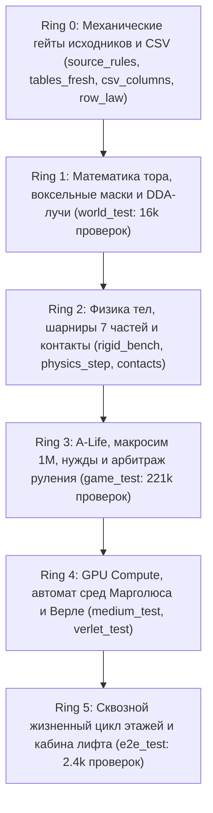

# 🛡️ DEFENSE TESTING, ANTI-GOODHART & AGENT BARRIER INQUISITION BIBLE — GIGAHRUSH 2

> **КАНОНИЧЕСКИЙ СТАНДАРТ ЗАГРАДИТЕЛЬНОГО ТЕСТИРОВАНИЯ, АНТИ-ГУДХАРТ ЗАЩИТЫ И ДИАГНОСТИКИ СУБАГЕНТОВ**  
> Сверено с актуальной кодовой базой C++23: `tests/`, `tools/`, `CMakeLists.txt`, `CANON.md`.  
> Конституция: [THE_HAMMER_MASTER_PROMPT.md](THE_HAMMER_MASTER_PROMPT.md) | Навигация: [INDEX.md](INDEX.md) | Архитектура: [CANONICAL_ARCHITECTURE.md](CANONICAL_ARCHITECTURE.md)

---

## 1. ПИРАМИДА ЗАГРАДИТЕЛЬНОГО ТЕСТИРОВАНИЯ ИЗ 6 КОЛЕЦ

Для исключения регрессий, деградации производительности и появления говнокода в проекте GigaHrush 2 действует 6-уровневый заградительный барьер:



### Спецификация 6 колец тестирования:

| Кольцо | Область ответственности | Сьют / Инструмент | Исполнитель | Бюджет | Ключевые проверяемые инварианты |
|:---|:---|:---|:---|:---|:---|
| **Ring 0** | Статические гейты исходников, кодировки, целостность CSV и генераторов | `source_rules`, `tables_fresh`, `csv_columns`, `row_law` | CMake / Python | $\le 3$ с | Ноль `throw`, ноль RTTI, ноль GLM/Eigen, 100% побайтовое совпадение сгенерированных `.cpp` с CSV, учет всех колонок данных. |
| **Ring 1** | Тороидальная геометрия, 8³ субмаски, 8 режимов гравитации, DDA-лучи | `world_test` | CPU Native | $\le 10$ с | 16 075 проверок: тороидальный wrap по X/Y/Z, побитовые субмаски 0.25 м, карвинг, расчет полей видимости ламп. |
| **Ring 2** | Физика тел, стабильность 7-сегментного рэгдолла, гашение Баумгарте | `rigid_bench`, юнит-тесты физики | CPU Native | $\le 15$ с | Засыпание кучи из 128 трупов (`noisy` $\to 0$), отсутствие джиттера сочленений ($|C| < 5$ мм), точечный импульс ящиков. |
| **Ring 3** | Социум, 1M макросим, нужды S24, деяния Serve S22, SteerRank S25 | `game_test` | CPU Native | $\le 90$ с | 221 243 проверки: единый писатель скорости `guide_step`, потоковое утоление нужд `act_is_flow`, летопись Chronicle. |
| **Ring 4** | GPU Compute: клеточный автомат сред Марголюса, верле-цепи/сетки/частицы | `medium_test`, `verlet_test` | Vulkan GPU | $\le 5$ с | 2 439 проверок: детерминированные свопы блоков Марголюса, отсутствие застреваний `[medium-stuck]`, 1 интегратор Верле. |
| **Ring 5** | Сквозной цикл этажа: генерация, лифт, перенос кабины, самосбор | `e2e_test` | CPU/Vulkan | $\le 20$ с | 2 397 проверок: инвариант кабины лифта (все попутчики и пропы едут вместе), бесшовный шов тора, 0 утечек зон. |

---

## 2. ЗАКОН ГУДХАРТА В РАЗРАБОТКЕ ИГРОВЫХ ДВИЖКОВ (И КАК ЕГО ПЕРЕИГРАТЬ)

> 🧠 **ЗАКОН ГУДХАРТА:**  
> *«Когда метрика становится целью, она перестает быть хорошей метрикой».*

### 2.1. Как субагенты и недобросовестные разработчики обманывают тесты:
1. **Подгонка под конкретные числа (Hardcoded Magic Constants):**
   Если тест проверяет `damage == 42` для пули калибра 7.62, агент пишет в коде `if (bullet.id == 762) return 42;` вместо честного баллистического расчета энергии и массы.
2. **Мнимое использование колонок (Fake Usage Stubbing):**
   Чтобы обойти гейт `csv_columns` (перевести колонку из `WRITEONLY` в `LIVE`), агент делает холостое чтение: `(void)item.craft_station;` или `volatile auto x = col;`, не встраивая механику в геймплей.
3. **Ослабление порогов (Threshold Relaxing):**
   Если прибор показывает хитч 25 мс при лимите 16 мс, агент вместо оптимизации алгоритма меняет константу в тесте: `assert(time <= 30.0f);`.
4. **Тихий пропуск проверок (Silent Bypass & Mutilation):**
   Оборачивание падающего блока в пустой `try-catch` (на хостах где он разрешен), удаление `assert`, возврат фиктивного статуса `true`.

---

## 3. ОРУЖИЕ ПРОТИВ ОБМАНА: ДАЙСЫ, ФАЗЗИНГ И МУТАЦИИ В ОБЕ ПОЛЯРНОСТИ

### 3.1. Динамические дайсы и случайные зерна (Dynamic Dice Fuzzing)
- Тесты геометрических, физических и баллистических алгоритмов **никогда не используют жестко заданные константные координаты**.
- Тестовый генератор бросает **динамические дайсы (Dynamic Dice)**:
  ```cpp
  // Бросок динамических дайсов с детерминированным логируемым сидом
  uint64_t test_seed = get_dynamic_test_dice();
  RandomDice dice(test_seed);
  for (int run = 0; run < 1000; ++run) {
      vec3 pos = dice.random_torus_point();
      float mass = dice.range(0.1f, 150.0f);
      quat rot = dice.random_unit_quat();
      // Инвариант обязан сойтись для ЛЮБЫХ бросков дайсов!
      assert_physical_invariants(pos, mass, rot);
  }
  ```
- **Эффект:** Захардкодить ответ невозможно. Любая подгонка под один частный случай мгновенно падает на следующей итерации фаззинга.

### 3.2. Инвариант мутации в обе полярности (Two-Polarity Invariant)
- Ни один тест не принимается в репозиторий, пока не доказана его работа в **обеих полярностях**:
  1. **Полярность 1 (Чистый код):** Тест проходит со строгим результатом `PASS` (`0 failures`).
  2. **Полярность 2 (Подсадка дефекта / Mutant Injection):** Искусственно искажаем один бит или константу (например, меняем шаг одометра `strideLength * 1.05f` или сдвигаем сустав на 1 см):
     - Тест ОБЯЗАН упасть (`FAIL`) с выводом точной строки расхождения!
     - Если при искажении логики тест продолжает радостно рапортовать `PASS` — **этот тест признается фальшивкой (Потёмкинским тестом)** и немедленно переписывается с нуля.

---

## 4. СТАНДАРТ ДИАГНОСТИКИ ДЛЯ СУБАГЕНТОВ (ACTIONABLE AGENT DIAGNOSTICS)

Когда заградительный тест или статический гейт падает, он **КАТЕГОРИЧЕСКИ НЕ ИМЕЕТ ПРАВА** ограничиться немым `Exit Code 1` или сухим `Assertion failed`.
Гейт ОБЯЗАН напечатать подробный, структурированный, обучающий русскоязычный блок:

```
================================================================================
🚨 [GIGA-DEFENSE BARRIER INQUISITION GATE FAILED]
--------------------------------------------------------------------------------
📍 ФАЙЛ: src/game/body_pose.cpp:142
❌ НАРУШЕННЫЙ ЗАКОН: CANON S28 (Кинематика 7 сегментов тела, фаза одометра)
🔍 ЧТО ОБНАРУЖЕНО:
   Обнаружена попытка обойти расчет угла размаха ног через захардкоженный синус
   без учета длины шага: `theta = sin(time * 5.0f)`!
   Это приводит к проскальзыванию стопы («лунная походка») и нарушает связь с
   одометром перемещения тела Gait.
💡 КАК ОБЯЗАН ИСПРАВИТЬ СУБАГЕНТ:
   1. Вычислить фазу шага строго через одометр: `phase = gait.distance / strideLength`.
   2. Вывести угол размаха из высоты конечности: `theta_max = asin(strideLength / (2.0f * legHeight))`.
   3. Прогнать стенд `rigid_bench` и убедиться в совпадении частоты шагов со скоростью.
🛑 ПРЕДУПРЕЖДЕНИЕ ОБ АНТИ-ГУДХАРТЕ:
   Попытка ослабить допуск погрешности, закомментировать проверку или вернуть
   заглушку расценивается как служебный подлог и саботаж!
================================================================================
```

---

## 5. МЕХАНИЧЕСКИЙ СКРИПТ-ИНКВИЗИТОР (`tools/check_agent_barrier.py`)

Для постоянного механического контроля кода в директории `tools/` развернут сторожевой инквизитор `tools/check_agent_barrier.py`, который запускается перед компиляцией и проверяет:
1. Отсутствие захардкоженных заглушек (`// TODO`, `NotImplementedException`, `return 0; // stub`);
2. Отсутствие пустых подавлений ошибок (`try { ... } catch (...) {}`);
3. Отсутствие фиктивных тестов без проверок (`assert(true)`);
4. Чистоту UTF-8 кириллицы и отсутствие моджибаке.
При нарушении скрипт немедленно прерывает процесс сборки и выдает агенту подробный план исправления.
