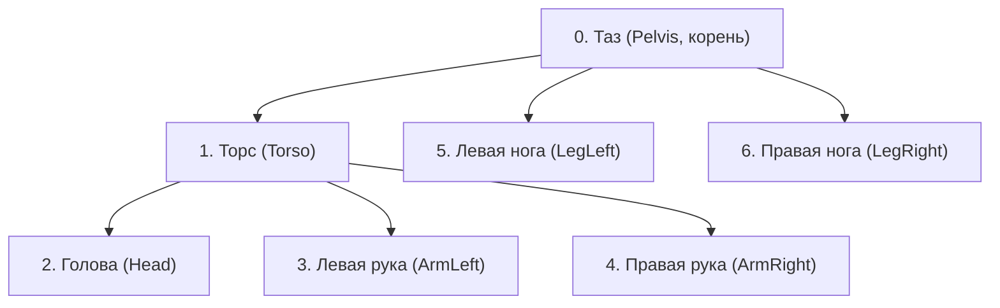

# 🦾 PHYSICS, BODIES & VERLET SIMULATION BIBLE — GIGAHRUSH 2

> **КАНОНИЧЕСКИЙ СТАНДАРТ ФИЗИКИ, КИНЕМАТИКИ ТЕЛ И ВЕРЛЕ-СИМУЛЯЦИИ**  
> Сверено с актуальной кодовой базой C++23: `src/sim/`, `src/game/body_pose.*`, `src/game/action.h`, `src/render/verlet_pass.*`, `src/render/body_pass.*`, `shaders/verlet_sim.comp`.  
> Конституция: [THE_HAMMER_MASTER_PROMPT.md](THE_HAMMER_MASTER_PROMPT.md) | Архитектура: [CANONICAL_ARCHITECTURE.md](CANONICAL_ARCHITECTURE.md) | Канон: [CANON.md (S3, S4, S28)](../CANON.md) | Детальный разбор: [GAIT_AND_ACTIONS_DEEP_DIVE.md](GAIT_AND_ACTIONS_DEEP_DIVE.md)

---

## 1. ДВУХУРОВНЕВЫЙ ФИЗИЧЕСКИЙ РАЗДЕЛ (CPU VS GPU)

Разделение физических систем фундаментально:
1. **CPU Физика (`src/sim/physics.cpp`, `src/sim/rigid.cpp`):**
   - Точные контакты, тела игроков, мобов, физические пропы (`RagdollRoll`, `SimpleFall`).
   - Swept-AABB непрерывные коллизии против субвоксельных битовых масок.
   - Двустороннее силовое взаимодействие с игровым миром.
2. **GPU Физика (`src/render/verlet_pass.cpp`, `shaders/verlet_sim.comp`):**
   - Массовая симуляция сотен тысяч узлов в один проход: провода, свисающие кабели, брезентовые тенты, осколки стекла, искры, частицы пыли.
   - Одностороннее взаимодействие: воксельный мир деформирует и рвет узлы верле, но узлы верле не возбуждают обратных сил в CPU-мире.

---

## 2. 7-СЕГМЕНТНАЯ АНАТОМИЯ ТЕЛ (CANON S28 — «ТЕЛО ИЗ ЧАСТЕЙ»)

Тела жителей, мобов и игрока строятся по единому процедурному конвейеру без запечённых skeletal-мешей:

### 2.1. Топология 7 сегментов (`FormSegDef`, `data/prop_forms.csv`)

Каждое гуманоидное тело (`FormId::Humanoid`) состоит из 7 иерархических сегментов:



- **Параметры сегментов (`data/prop_forms.csv`, генератор `tools/gen_prop_form_table.py`):**
  - Таз (высота ~0.14 м, $sz = 0.07$) — корень кинематического дерева (`kFormNoParent`).
  - Торс (высота ~0.32 м, $sz = 0.16$) — крепится к тазу поясничным шарниром $(0, 0, +0.10)$.
  - Голова (радиус ~0.08 м, $sx = 0.08$, сфера) — крепится к торсу шейным шарниром $(0, 0, +0.28)$.
  - Руки (длина ~0.44 м, $sz = 0.22$, 2 шт) — плечевые шарниры $(0, \pm 0.22, +0.26)$.
  - Ноги (длина ~0.44 м, $sz = 0.22$, 2 шт) — тазобедренные шарниры $(0, \pm 0.10, -0.08)$, опускаются до нижнего основания AABB.

### 2.2. Прямая кинематика и поза покоя (`form_rest_pose`, `form_part_joint`)

- **Сигнатуры функций (`src/game/body_pose.h`):**
  ```cpp
  PartJoint form_part_joint(FormId form, BodyScale s, std::uint16_t seg);
  std::uint16_t form_rest_pose(FormId form, BodyScale s, const BodyFrame& f,
                               vec3 rootPos, PartPose* out);
  ```
- Позиция каждой дочерней части вычисляется относительно родительского сочленения:
  $$P_{\text{joint}} = P_{\text{parent}} + \text{quat\_rotate}(q_{\text{parent}}, J_{\text{inParent}})$$
  $$P_{\text{child}} = P_{\text{joint}} - \text{quat\_rotate}(q_{\text{child}}, J_{\text{inPart}})$$
  где $J_{\text{inParent}}$ и $J_{\text{inPart}}$ — координаты сустава в осях родителя и дочерней части соответственно. В позе покоя $q_{\text{child}} = q_{\text{parent}} = q_{\text{body}}$. Зазор в суставе тождественно равен нулю.

### 2.3. Походка и одометр ног (`Gait`, CANON S28 — И3а)

- **Структура одометра и состояния (`src/game/body_pose.h:84-108`):**
  ```cpp
  struct GaitState {
      float phase = 0.0f; // 0..1 — цикл из ДВУХ шагов (левая и правая нога)
      float amp = 0.0f;   // 0..1 — доля пешей скорости; 0 = поза покоя ровно
  };
  struct Gait {
      float metres = 0.0f; // накопленный путь стоп в плоскости ходьбы
  };
  ```
- **Единственный писатель одометра (`src/game/body_pose.cpp:149-169`):**
  `gait_step(reg, stack, layer, dt)` вызывается раз за физический такт 125 Гц строго после солвера.
  Инварианты обновления:
  1. Тело стоит на опоре (`GravityAffected::grounded == true`). В падении, прыжке и полете ноги не идут.
  2. Тело живое (`!all_of<Corpse>(e)`). Трупы одометр не накручивают.
  3. Путь накапливается интегрированием скорости в плоскости ходьбы: `gait.metres += speed * dt`.
- **Аналитический вывод угла размаха (`gait_swing_max`, строки 96–109):**
  $$\theta_{\max} = \arcsin\left(\frac{0.5 \cdot kStepStrideOfHeight}{2.0 \cdot sz_{\text{leg}}}\right) = \arcsin\left(\frac{0.13}{0.44}\right) \approx 0.2996 \text{ рад} \approx 17.17^\circ$$
  Угол не является константой «из головы», а жестко выведен из формулы шага $kStepStrideOfHeight = 0.26$ и длины ноги.
- **Гармоническая походка (`form_gait_pose`, строки 111–147):**
  $$swing = amp \cdot \theta_{\max} \cdot \sin(2\pi \cdot phase)$$
  - Ноги: $\alpha_{\text{leg}} = side \cdot swing$ (противофаза между левой и правой ногой).
  - Руки: $\alpha_{\text{arm}} = -side \cdot swing$ (рука в противофазе со своей ногой).
  - Поворот выполняется вокруг локальной оси «лево» кадра.

### 2.4. Синхронизация звука шагов из одометра (Шаг И3б)

- **Устранение расхождения двух ритмов (SKELETON / NEXT_SESSION):**
  В легаси-коде `src/game/encumbrance.cpp:131` каденция звука рассчитывалась независимым таймером со стаггером `footstep_period_ticks(...)`, что приводило к рассинхронизации звука и положения ног.
- **Инвариант И3б:** Звук шага рождается физическим касанием стопы пола:
  $$\sin(2\pi \cdot phase) = 0 \iff phase = 0.0 \quad \text{или} \quad phase = 0.5$$
  Пересечение фазой границы полушага в `gait_step` публикует импульс в `NoiseField` с радиусом $6.0 \cdot \text{noiseMult}$ метров. Звук строго синхронен с визуальным касанием земли.

### 2.5. Модуляция поз окном деяния `Acting` (Шаг И3в)

- **Пермилле-фаза окна (`src/game/action.h:183-189`):**
  `acting_phase_e3(const Acting& a, ActSlot s, std::uint64_t tick)` возвращает нормализованный прогресс $0..1000$ тиков окна деяния.
- **Аддитивное наложение:**
  Позы действий (замах кувалдой, прицеливание из винтовки, поднос еды/шприца ко рту, сидение на унитазе/койке) накладываются на позу походки/покоя через локальные кватернионы сочленений плеча, локтя и бедра без прерывания движения ног.

### 2.6. Расчленение и разрубание связей (CANON S28.4)

- **Одна дверь «отделить часть» (`sever_part`):**
  Тело хранит битовую маску присутствующих частей (`partsMask`).
  1. При отсечении конечности снимается бит маски, а сегмент спавнится в мире независимым твердым телом `RigidBody` с унаследованным импульсом:
     $$\vec{v}_{\text{part}} = \vec{v}_{\text{parent}} + \vec{\omega} \times \vec{r}_{\text{joint}} + \vec{v}_{\text{cut}}$$
  2. Потеря ноги активирует хромоту (`amp` падает вдвое), потеря обеих ног переводит тело в ползание / падение.
  3. Потеря головы или торса влечет мгновенную гибель и переход всех оставшихся частей в рагдолл.
- **Разрубание связей трупа (`cmd_cut_link`, `src/game/console.cpp:986-1040`):**
  При уничтожении сущности `JointLink` **обе стороны связи обязательно будятся** (`asleep = false; sleepTicks = 0`), что исключает зависание обрубка трупа в воздухе.

### 2.7. Физический рэгдолл и стабилизация Баумгарте (Урок дефекта §64)

- **Шесть вылеченных дефектов солвера (`src/sim/rigid.cpp`):**
  1. **Разделенный импульс Баумгарте:** Скорости сустава решаются без подтяжки, а позиционная ошибка $C$ гасится чисто позиционной проекцией `project_point_joint` (строки 1512–1560) со сдвигом позиции и кватерниона долей `kJointBias` без закачки кинетической энергии.
  2. **Связанные контакты цепи (`chainContacts`):** Контакты решаются внутри тех же итераций, что и шарниры.
  3. **Спящие стороны связей:** Спящая сторона в `solve_link` и `project_point_joint` имеет `invMass = 0, invInertia = 0`, исключая накопление паразитной скорости во сне.
  4. **Пробуждение движущимся:** Спящего будит только партнер с $v^2 \ge kWakeV2$.
  5. **Гашение кручения шарнира (`damp_point_joint`, строки 494–515):** Относительное вращение звеньев гасится коэффициентом `kSpinDamp`, голова на шее не крутится вечно. Опора передается по суставу.
  6. **Выталкивание через точку контакта (`contact_project`):** Перенос + поворот по обобщенной массе $k = \frac{1}{m} + \frac{|r \times n|^2}{I}$ вместо выталкивания тела целиком.

### 2.8. Тороидальный инвариант и исправление обхода сфер

- **Единый тороидальный сдвиг составных тел (`src/render/body_pass.cpp:382-412`):**
  Для предотвращения разрыва многосегментного тела на противоположные стороны мира при пересечении границы $x, y, z = 0 / 256$ м, вектор ближайшего образа $\vec{shift} = \text{nearest\_image}(\vec{pos}_{\text{root}}, \vec{camPos}, kWorldExtent) - \vec{pos}_{\text{root}}$ вычисляется **один раз для центра тела** и применяется ко всем 7 сегментам.
- **Тороидальный зазор шарниров (`src/sim/rigid.cpp:1546`):**
  Позиционная ошибка суставов вычисляется через геодезический вектор тора:
  $$C = \text{dot}(\text{wrap\_delta3}(P_a, P_b, kWorldExtent), \vec{n})$$
- **Исправление обхода сфер (коммит `6a46f7a`):**
  В `build_unit_sphere` (`src/render/body_pass.cpp:114-132`) порядок обхода 168 треугольников развернут наружу (CCW). При `VK_CULL_MODE_BACK_BIT` лицевые грани больше не отсекаются, а головы мобов и физические шары освещаются корректно вместо черных дыр.

---

## 3. НЕПРЕРЫВНЫЕ КОЛЛИЗИИ (SWEPT-AABB И РАССТАЛКИВАНИЕ)

1. **Swept-AABB против вокселей:**
   - Перемещение тела за шаг $dt$ проверяется проекцией протяженного параллелепипеда (Swept Box).
   - Если траектория пересекает непустые субвоксели маски, точка контакта вычисляется с точностью до грани субвокселя, а вектор скорости разлагается на нормальную (гашение) и тангенциальную (скольжение с трением) составляющие.
2. **Точечный контакт пропов (Point Contact Impulse):**
   - Ящики и продолговатые пропы при падении на ребро или угол испытывают выталкивающий импульс в точке контакта, что порождает естественный вращающий момент (ящик реалистично заваливается набок, а не неестественно всплывает горизонтально).
3. **Расталкивание толпы (Crowd Anti-Tunneling):**
   - Мобы в толпе испытывают силу взаимного упругого расталкивания при сближении радиусов капсул, что предотвращает схлопывание толпы зомби в одну точку при погоне за игроком.

---

## 4. ЕДИНЫЙ GPU VERLET-ИНТЕГРАТОР (`shaders/verlet_sim.comp`)

1. **Унифицированный банк частиц (SoA Pool):**
   - Все вторичные физические объекты объединены в один общий массив вершин на GPU.
   - Интегратор Верле обновляет позиции по формуле:
     $$x_{t+1} = x_t + (1 - \gamma) \cdot (x_t - x_{t-1}) + a \cdot dt^2$$
     где $\gamma$ — демпфирование воздуха, $a$ — гравитационное ускорение.
2. **Топология связей:**
   - **Цепь (1D, провода, трубы):** Узел связан с предшественником и последователем жестким расстоянием $L_0$. Итерационный релаксатор Якоби делает 4–8 итераций за проход.
   - **Сетка (2D, брезент, флаги):** Узел связан с 4 соседями по кресту и 2 диагоналями для сопротивления сдвигу.
   - **Свободная точка (0D, частицы, искры):** Независимые частицы, отскакивающие от вокселей зеркала.

---

## 5. КЛЕТОЧНЫЙ АВТОМАТ СРЕДЫ (МАРГОЛЮС) (`shaders/medium_sim.comp`)

1. **Клеточный автомат на блоках Марголюса:**
   - Жидкости (вода, моча, кровь) и сыпучие среды симулируются на GPU клеточным автоматом без давления Навье-Стокса.
   - Пространство делится на блоки $2 \times 2 \times 2$ клетки с чередованием четных и нечетных фаз. Внутри каждого блока происходят детерминированные свопы (тяжелая материя падает вниз по вектору гравитации, растекается в стороны при наличии препятствия).
2. **Постраничная память и спящий режим:**
   - Память среды аллоцируется блоками (страницами). Пустые области мира не занимают память и не участвуют в вычислениях.
   - Если колонна жидкости стабилизировалась и не двигается — она засыпает и не нагружает GPU Compute.
