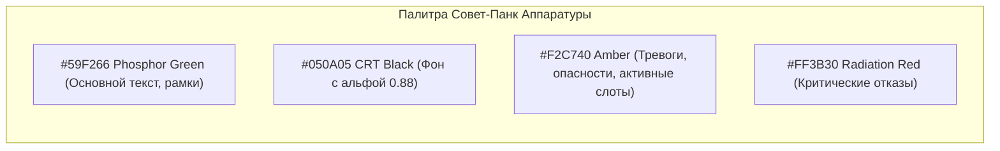

# 📺 VULKAN RAYMARCHER, LIGHTING & SOVIET-PUNK CRT UI BIBLE — GIGAHRUSH 2

> **КАНОНИЧЕСКИЙ СТАНДАРТ РЕНДЕРИНГА, ОСВЕЩЕНИЯ И СОВЕТ-ПАНК ИНТЕРФЕЙСА**  
> Сверено с актуальной кодовой базой C++23 / GLSL: `src/render/`, `shaders/raymarch.frag`, `src/render/imgui_layer.cpp`.  
> Конституция: [THE_HAMMER_MASTER_PROMPT.md](THE_HAMMER_MASTER_PROMPT.md) | Архитектура: [CANONICAL_ARCHITECTURE.md](CANONICAL_ARCHITECTURE.md) | Канон: [CANON.md (S5)](../CANON.md)

---

## 1. VULKAN РЕНДЕР: ЧИСТАЯ ЧИТАЮЩАЯ ОБОЛОЧКА (READ-ONLY SHELL)

1. **Односторонний поток данных (Sim $\to$ Render Only):**
   - Рендерер — это визуальный проектор состояния симуляции.
   - Рендерер **никогда** не изменяет переменные симуляции, не передвигает сущности и не отвечает на геймплейные вопросы (видимость цели, дальность огня). Все игровые проверки рассчитываются строго в CPU-симуляции по субмаскам.
   - Игра обязана быть на 100% функциональной в headless-режиме без окна и без видеокарты (для юнит-тестов и симуляции макромира).
2. **Тороидальный обзор от камеры (Always Render Around the Camera):**
   - Мир бесконечен во все стороны из-за тора. Чтобы исключить визуальные разрывы, каждый объект и каждая ячейка мира рисуются в **ближайшем тороидальном образе (Nearest Toroidal Image)** относительно текущей позиции камеры.
   - Камера всегда находится в центре бесшовной сферы радиусом $R = 128.0$ метров.

---

## 2. ВОКСЕЛЬНЫЙ РЕЙМАРШЕР (`shaders/raymarch.frag`)

1. **Двухуровневый DDA-маршинг луча:**
   - Для каждого пикселя экрана запускается луч из фокуса камеры.
   - **Уровень 1 (Макро-сетка 2.0 м):** Алгоритм Fast Voxel Traversal шагает по граням макро-клеток $128^3$. Если клетка пуста (`Air`) — переход к следующей границе ячейки за несколько операций `fma`.
   - **Уровень 2 (Субвоксели 0.25 м):** При попадании в непустую клетку луч входит во внутренний DDA-цикл по битовой маске $8^3$. Трассировка идет до первого бита `1` (твердый воксель).
2. **Бесшовный туман тора (Black Distance Fog):**
   - Туман расстояния угасает в **абсолютно черный цвет (`#000000`)** на дистанции $kWorldExtent / 2 = 128.0$ метров.
   - Синий, серый или белый туман категорически запрещены. Черный туман идеально скрывает тороидальный шов, создавая клаустрофобическую атмосферу бесконечной циклопической мегаструктуры без видимых границ.

---

## 3. СВЕТОСЕТКА И БЕЙК ОСВЕЩЕНИЯ (DDA LIGHT GRID)

1. **Света от камеры не существует (No Headlamp Hack):**
   - В игре нет фиктивных источников света, привязанных к камере игрока. Фонарик в руке — это реальный предмет (`flashlight`), создающий физический световой конус от руки персонажа, видимый как игроку, так и всем окружающим NPC.
2. **Структура `GpuLightGrid`:**
   - Пространство этажа разбито на кластеры световой сетки. Каждый кластер хранит индексы активных ламп, влияющих на данную область.
   - Лампочка — это разрушаемый проп (`GpuHandoff`). При разбитии лампочки свет немедленно гаснет, осколки уходят в GPU-пул частиц, а светосетка перестает учитывать выключенный источник.
3. **Запекание видимости света (Light Visibility Bake):**
   - При генерации или загрузке этажа фоновый поток выполняет бейк матрицы видимости ламп.
   - Проверка видимости использует **9 субвоксельных лучей с оракулом дилатации**, что полностью исключает эффект «света сквозь стены» даже при наличии тонких перегородок из лепки толщиной в 1 субвоксель (25 см).

---

## 4. СОВЕТ-ПАНК CRT UI МАНДАТ ("ИНТЕРФЕЙС ЦЕ ВАЖНО")

Интерфейс GigaHrush 2 — это интерфейс **тяжелой советской промышленной аппаратуры**, контрольно-измерительных приборов и монохромных терминалов:



### 4.1. Геометрия ImGui (`src/render/imgui_layer.cpp`)
- **Тотальный запрет скруглений (Zero Rounding Invariant):**
  ```cpp
  style.WindowRounding    = 0.0f;
  style.ChildRounding     = 0.0f;
  style.FrameRounding     = 0.0f;
  style.PopupRounding     = 0.0f;
  style.ScrollbarRounding = 0.0f;
  style.GrabRounding      = 0.0f;
  style.TabRounding       = 0.0f;
  ```
- **Четкие индустриальные границы:**
  ```cpp
  style.WindowBorderSize  = 2.0f;
  style.FrameBorderSize   = 1.0f;
  style.PopupBorderSize   = 1.0f;
  ```
- **Полупрозрачный кинескоп (CRT Alpha Bleed):**
  Фон окон имеет полупрозрачность `alpha = 0.88` на цвете `#050A05`. 3D мир, лучи света и силуэты монстров просвечивают сквозь открытые формуляры и приборные панели, создавая ощущение реального светящегося кинескопа.

### 4.2. Элементы интерфейса
- **Карточки и перфокарты:** Меню и инвентарь оформлены как перфокарты, бланки отчетов и паспорта оборудования.
- **Индикаторы и тумблеры:** Никаких мягких переключателей. Только тяжелые щелкающие тумблеры, сегментные шкалы, светодиодные индикаторы и пиксельные моноширинные шрифты.
- **Штрих и виньетирование:** Легкое сканирующее дрожание строк (Scanlines) и аберрация по краям экрана, имитирующая выпуклое стекло монитора ЭЛТ.
