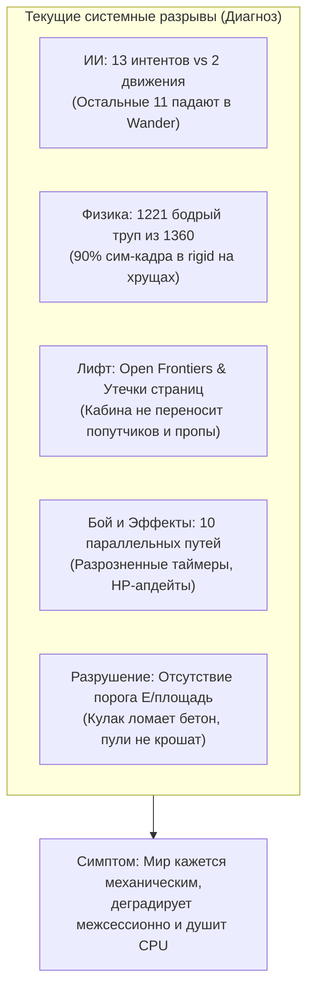
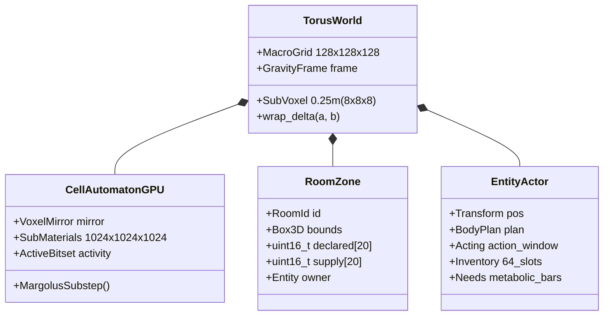
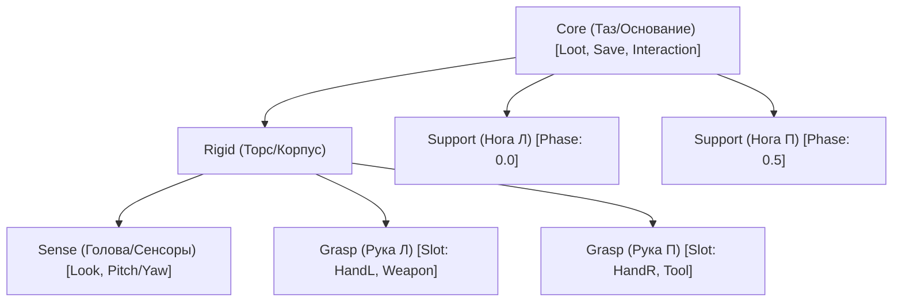
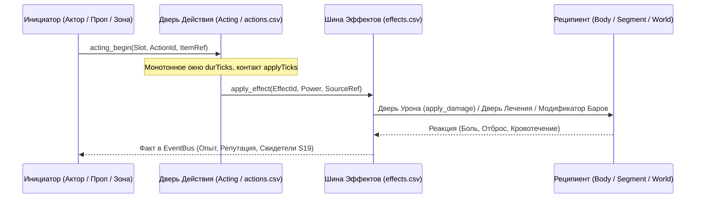
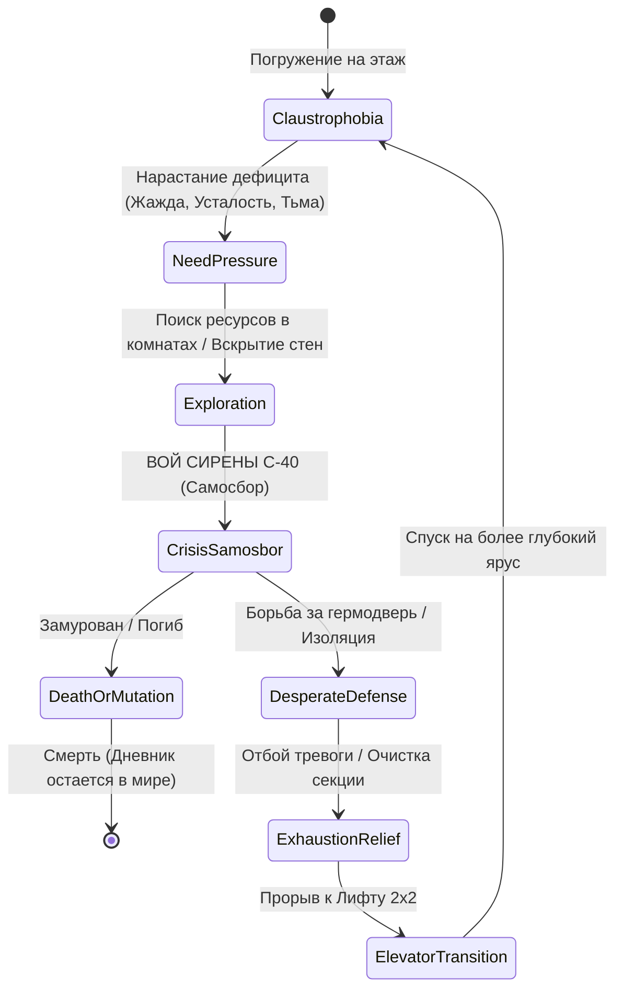
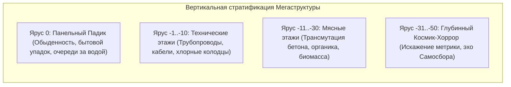

# МОНУМЕНТАЛЬНЫЙ СТРАТЕГИЧЕСКИЙ МАНИФЕСТ И ГЕНЕРАЛЬНЫЙ ПЛАН РАЗВИТИЯ БЭКЕНДА И СИСТЕМ GIGAHRUSH 2
> **SSOT СИСТЕМНОЙ АРХИТЕКТУРЫ, ИГРОВОЙ ЛОГИКИ, ЭМЕРДЖЕНТНОСТИ И ХОРРОР-СИМУЛЯЦИИ**  
> *Версия: 1.0.0-CANONICAL*  
> *Статус: ВЕРХОВНЫЙ СТРАТЕГИЧЕСКИЙ МАНИФЕСТ РАЗВИТИЯ (SSOT)*  
> *Канонический фундамент: CANON.md (системы S1–S31), matwej.md, problems.md, SKELETON.md*  
> *Назначение: Прямое техническое и концептуальное руководство для архитекторов и агентов разработки ядра `gigahrush2`.*

---

## ПРЕАМБУЛА: ВЕЛИКАЯ СИМУЛЯЦИЯ ГИГАХРУЩА

GigaHrush 2 — это **не заскриптованная инди-бродилка и не витрина разрозненных механик**. Это бескомпромиссный, изотропный, тороидальный **воксельный симулятор замкнутой биосоциальной мегаструктуры**.
Здесь нет бутафории и «фальшивых стен»: каждый кубический метр железобетона, каждый силовой провод под потолком, каждый осколок ртутной лампы, каждая капля технической жижи или мочи, каждый труп и каждый патрон существуют в едином координатном, физическом и предметном поле.

Игрок в этой вселенной — **не избранный мессия**. Он — смертный биологический объект (`CameraTag` + `Controller` на обычном теле `NpcRef`), на которого с одинаковой беспристрастной жестокостью давят:
1. **Физика замкнутого пространства:** клаустрофобия бесконечных коридоров, внезапная тьма при авариях сетевых щитков, скопление ядовитого хлора в колодцах, смертоносные рикошеты, осыпающийся щебень и обрушение панельных перекрытий.
2. **Биология выживания:** голод, сушащая жажда, переполнение мочевого пузыря, физическое истощение, механические травмы конкретных сегментов тела и кровопотеря.
3. **Социум отчаяния:** миллион жителей мегаструктуры, распределенных по холодным и горячим ярусам, делящих скудный паёк, торгующих в проходах, патрулирующих секции, убивающих из страха или наживы и запускающих эмерджентные цепочки вендетты.
4. **Неумолимый системный рок — Самосбор:** не заскриптованный синематик, а **динамическая волновая перестройка геометрии этажа клеточным автоматом**, пожирающая незагерметизированные секции, наполняющая коридоры удушающим туманом и выплескивающая плотоядных мутантов.

Настоящий манифест вскрывает анатомию текущего системного тупика кодовой базы, утверждает незыблемые архитектурные инварианты Великой Симуляции, описывает психологическую петлю удержания игрока на 100+ часов и предоставляет исчерпывающую пошаговую инженерную дорожную карту пересборки бэкенда.

---

## 1. АНАТОМИЯ ТЕКУЩЕГО СИСТЕМНОГО ТУПИКА (ЧЕСТНЫЙ ДИАГНОЗ ПО КОДУ И КАНОНУ)

Сплошной аудит кодовой базы, профилировочных срезов (`matwej.md`, `problems.md`) и канонических спецификаций выявил ряд глубоких системных разрывов между замыслом архитектора и физической реальностью исполнения.



### 1.1. Разрыв ИИ и симуляции жизни: 13 интентов против 2 движений
- **Фактическое состояние кода (`src/game/ai.cpp`):**
  В перечислении объявлено 13 утилити-интентов (`IntentFlee`, `IntentPatrol`, `IntentDrink`, `IntentEat`, `IntentSleep`, `IntentWork` и др.). Однако при арбитраже движения собственную локомоцию имеют **ровно ДВА интента**:
  1. `IntentFlee` (`ai.cpp:810-850`) — бегство по анти-градиенту поля опасности (`danger`).
  2. `IntentPatrol` (`ai.cpp:891-950`) — перемещение между зонами патрулирования.
  
  Все остальные 11 интентов исполняют один и тот же делегат (`ai.cpp:861-869`):
  ```cpp
  if (!owned) {
      ++out.wanderOwned;
      continue; // Отдача тела в wander_step
  }
  ```
  Ветка нарядов (`ERRAND`) была объявлена мертвой и снесена при удалении старых flow-полей. В результате агент, выбравший «жажду», «голод» или «работу», переходил в обычное случайное блуждание (`Wander`), пока случайным образом не наступал на нужную клетку.
- **Дисбаланс потребностей и смертность:**
  До внедрения `CANON S24` (`serve.cpp`) приход в целевую комнату заканчивался строкой `place.cpp:295`:
  ```cpp
  ++out.arrived; plan.room = kNoRoom; ++out.idle; continue;
  ```
  Агент отпускался тем же тиком, не потребив запаса и не снизив нужду. Нужды только падали (жажда со скоростью `0.12/с`, голод `0.08/с`). В замерах за 28 минут симуляции погибало 32 жителя от обезвоживания, а 59% толпы перманентно находилось в состоянии жажды (`drink`), превращая этаж в зомби-массу иссохших скитальцев. Внедрение `serve.cpp` закрыло звено потребления («стою там, где предлагают»), но обнажило следующий тупик: агенты не имеют целеполагания на уровне предметов внутри комнат и не способны к эмерджентному планированию.

### 1.2. Лифты, этажи и бесконечный рост страниц памяти (Open Frontiers)
- **Инвариант каркаса против реальности:**
  Согласно `CANON S9.1` и `CANON S27.12`, лифтовые шахты 2×2 на координатах `{16, 80}²` — это неизменный инвариант каркаса мегаструктуры во всех 128³ торах. Поездка в лифте обязана быть бесшовной загрузкой (Dead Space-style), где **кабина переносит не просто тело с камерой, а весь объем шахты 2×2**: попутчиков-жителей, мобов, лежащие ящики, трупы и даже скопившиеся субвоксели сред (воды/обломков).
- **Разрыв в коде (`src/game/elevator.cpp`):**
  Функция `ride_elevator` принимает строго одного `Entity player` и обновляет `Transform::layer`, `pos` и координаты в пуле `NpcPool`. Все остальные объекты, зашедшие в кабину вместе с игроком, остаются на покинутом этаже: жители сворачиваются в пул покинутого этажа, мобы зачищаются метлой слоя, пропы и предметы уходят в сериализованный снимок.
- **Деградация памяти зеркала и шва сред:**
  На жилом этаже 0 слот `med_apply` (CPU-шов клеточного автомата сред) занимает **2.78 мс из 4.65 мс = 60% всего сим-кадра**. Механизм `open_frontier` при открытии фронтиров материализует страницы на GPU. При частых переходах между этажами и накоплении сейва (за 13 прогонов) объем живых клеток сред вырастает с 8 975 до **221 831**, вызывая обвал кадра до 92.29 мс (`gpu simphys` 77.74 мс). Страницы зеркала растут монотонно (до 1 961 049 страниц = 93.5% жесткого капа), так как очистка спящей однородной материи не доведена до автоматического схлопывания.

### 1.3. Разрозненность действий, урона, статусов и таймеров (Хаос боевых шин)
- **10 параллельных систем одного смысла:**
  Вместо единой канонической шины «Актор -> Действие -> Эффект -> Реципиент» в коде сосуществуют:
  1. *Лечение:* 5 независимых писателей HP вверх (прямой `use_best_heal`, списание `hpBank` без продюсеров, мобы в воде с литералом `0.13`, левел-ап `award_xp`).
  2. *Статусы:* Два параллельных замедления (`Slowed` в ECS-компонентах с таймером в миллисекундах и `StatusSet` локальной переменной в `main.cpp`). Паутина пишет в оба!
  3. *Кулдауны:* Окно `Acting` сосуществует со старыми счетчиками `cooldownMs` и независимым хеш-каденсом драки NPC в `faction_relations.cpp:202` (шанс 1/64 каждые 20 секунд, без учета оружия и дистанции).
  4. *Урон и защита:* `apply_damage` в `combat.cpp` работает через каналы и броню, но урон от печати Самосбора наносится напрямую в `main.cpp`, минуя проверку герметичности укрытия (`playerSheltered = false` жестко зашит литералом).

### 1.4. Физика твердых тел: катастрофа «1221 бодрого трупа» (§64)
- **Замер на демо-этаже Khrushi 6 (`matwej.md`):**
  На демо-этаже слот `rigid` занимает **2.97 мс из 3.30 мс = 90% сим-кадра**. Из 1360 твердых тел бодрствующими являются **1221 тело (90%)**, из них 341 — трупы!
- **Причина вечной дрожи:**
  Сегменты одного рагдолла сталкивались друг с другом через контактные сферы. Контактная фаза разводила их позиционно на полную глубину проникновения, а суставной солвер `JointLink` тянул их обратно импульсом скорости ($\beta \cdot C / h = 50 \cdot C$). Это создавало предельный автоколебательный цикл с постоянной ошибкой в 10 см и фиктивной скоростью 4.9 м/с.
  Кроме того, в импульсной схеме без накопления контактных сил (warm starting) нормальный импульс покоя $j_n \approx g \cdot h \approx 0.04$ м/с, поэтому максимальная сила трения покоя $j_t \le \mu \cdot j_n \approx 0$. Статического трения не существовало: тела удерживались на склонах исключительно порогом засыпания `kSleepV`, а в кучах будили друг друга вечно.

### 1.5. Разрушение геометрии: отсутствие энергетического порога и тупик обвалов
- **Проблема «зубочистки против бункера»:**
  Вероятность карвинга субвокселя сегодня не учитывает площадь контакта и удельную энергию инструмента. Кулак при достаточной частоте ударов способен прогрызть армированную гермостену.
- **Зависание рыхлой материи (`rubble_*`):**
  При обрушении стен вырезанный объем переводится в рыхлый материал. Однако из-за разрыва связи между клеточным автоматом на GPU и масками геометрии на CPU (`VoxelMirror`) подвижные атомы обвала зависали в воздухе или превращались в непроходимые фантомы, блокирующие нав-сетку.

---

## 2. СИСТЕМНЫЕ ИНВАРИАНТЫ ВЕЛИКОЙ СИМУЛЯЦИИ

Чтобы навсегда ликвидировать архитектурную энтропию, устанавливаются фундаментальные системные законы, обязательные для любого модуля симуляции.



### 2.1. Изотропный тор 128³ и закон двух масштабов (S1, S2)
1. **Тороидальная метрика:** Пространство замкнуто по всем трем осям $X, Y, Z \in [0, 256\text{ м})$. Любое вычисление расстояния, пеленга, видимости, диффузии полей и физического импульса выполняется строго через минимальный тороидальный образ (`wrap_delta_f`). Привилегированных осей не существует.
2. **Гравитационный фрейм:** Понятия «абсолютный низ = -Z» запрещено. Направление тяжести задается структурой `GravityFrame` через тензор ориентации. Вектор гравитации читается по месту: `world.gravity().at(pos)`.
3. **Закон двух масштабов:**
   - **Физическая правда — это АТОМЫ (субвоксели 0.25 м, 8³ на макроклетку).** Все локальные вопросы (трассировка луча пули, точка крепления якоря, нормаль скола, контакт шара тела, пламя, электрическая искра) адресуются строго к субвоксельной маске `SubMask` и байту материала `sub_material`.
   - **Макроклетка 2 м — это каркас абстракций и кэш.** Используется исключительно для глобальных полей (`danger`, `noise`), грубого графа зон (`ZoneNav`), биннинга источников света и комнатного зонирования (`roomAt`).
   - *Запрет:* Использование типа клетки `CellType` или предикатов `grid.cell(...)` в локальных вопросах коллизии, пробития или освещения квалифицируется как критический архитектурный дефект.

### 2.2. Архитектура тела: Сегментное дерево и атомный слой (S28.7, S31)
Никаких монолитных кубов или жестко зашитой гуманоидной анатомии в коде движка.



1. **План тела (`BodyPlan`):**
   Любое существо (человек, хищный слизневик, 16-ногий паук, крыса, турель) описывается плоской конфигурацией сегментов в `data/prop_forms.csv` (до 32 сегментов, степень двойки).
   Каждый сегмент несет:
   - Относительный суставной оффсет `jointOffset` и ориентацию покоя `restQuat`.
   - Габарит примитива (полуоси эллипсоида/коробки) и долю массы.
   - **Функциональный водитель (`PartDriver`):**
     - `core` — корень тела (якорь инвентаря, интеракций и метаболизма).
     - `rigid` — пассивный структурный сегмент.
     - `sense` — слежение за направлением взгляда (голова, фасетка, перископ).
     - `support` — опорная конечность шагового цикла (несет фазовый сдвиг $\phi \in [0, 1)$).
     - `grasp` — манипулятор/хват (привязан к слоту удержания предметов `ActSlot::HandL / HandR`).
     - `chain` — звено гибкой кинематической цепи (хвост, щупальце, сегмент червя).
2. **Атомный слой присутствия (S31):**
   Каждый активный сегмент тела проецируется в разреженный субвоксельный слой этажа (страницы $8^3$ субвокселей с идентификатором владельца). 
   - **Коллизия выстрела:** Трассировка пули (`sub_march`) идет по физическим атомам. Пуля попадает в **первый встреченный атом тела**, вычисляя урон конкретному сегменту с учетом его брони и множителя уязвимости (попадание в `sense` = крит).
   - **Заслонение:** Тела честно заслоняют друг друга. Труп на полу поглощает пули и осколки.

### 2.3. Единая шина «Действие -> Эффект -> Реципиент» (S22, S29)
Уничтожение разрозненных статус-таймеров, прямого списания здоровья и частных кулдаунов.



1. **Действие (`Action`):** Занимает время в слоте актора (`ActSlot::HandL`, `HandR`, `Body`). Параметры приходят из `data/actions.csv` (`dur_ms`, `apply_ms`, маска обрыва `break_mask`). Состояние занятости — чистая функция времени: `tick - startTick < durTicks`. Никаких покадровых декрементов.
2. **Эффект (`Effect`):** Строка `data/effects.csv`. Несет:
   - Адрес целевой переменной: `HP`, `Stamina`, `Hunger`, `Thirst`, `Bladder`, `Speed`, `BleedRate`, `Psi`.
   - Операцию: мгновенное изменение (`Delta`), длительный квантовый поток (`Flow`), мультипликативный множитель (`Mult`).
   - Длительность и знак.
3. **Источники агностичны:** Эффект порождается оружием в руке, съеденной банкой тушенки, контактом с серной кислотой в вокселях, триггерной зоной гермокомнаты или аурой кричащего мутанта через одну и ту же сигнатуру `effect_apply`.

### 2.4. Решение агента: Единая сумма потребностей и предложений (S13.2, S13bis)
Устранение 13 разрозненных формул полезности. Агент выбирает цель **единой скалярной сверткой**:

$$\text{Score}(\text{Agent}, \text{Target}) = \sum_{v \in \text{Verbs}} \left( \text{Demand}[v] \times \text{Offer}[v] \right) - \text{Cost}(\text{Path}) - \text{Cost}(\text{Crowd}) - \text{Cost}(\text{Danger}) + \text{Affinity}(\text{Anchor})$$

1. **Глаголы (`verbs.csv`):** Общий язык предметов, пропов, комнат и агентов (20 базовых глаголов: `eat`, `drink`, `sleep`, `toilet`, `shelter`, `work`, `loot`, `flee`, `attack` и др.).
2. **Спрос агента (`Demand`):** Формируется метаболическими нуждами (`Needs`), профессиональной ролью (`RoleDef`) и сиюминутной угрозой. Зависимость нелинейная — порог резкого взвинчивания спроса берется из строки глагола `kVerbPatienceE3` (терпение сортира низкое, терпение работы высокое).
3. **Предложение цели (`Offer`):** 
   - Комната суммирует: `Declared` (архитектурное назначение модуля) + `Equipment` (пропы внутри) + `Stock` (предметы в контейнерах и трупах) + `Ambience` (свет, чистота воздуха).
   - Сущность предлагает себя: труп предлагает глаголы лута, кровать — `sleep`, враг — `attack`.
   - Точка под ногами предлагает базовый минимум (спать на полу грязно, но возможно).
   - Полевое градиентное предложение: бегство от опасности $\nabla(\text{danger}) \downarrow$.
4. **Решатель движений (`SteerRank`):** Интенты не имеют собственного закрытого кода перемещения. Система ведения (`guide_step`) принимает заявки на перемещение с рангом приоритета:
   $$\text{Walk} < \text{Chase} < \text{Feud} < \text{Errand} < \text{Patrol} < \text{Flee}$$
   Писатель скорости строго один — паразитные перетирки исключены на уровне компиляции.

### 2.5. Мир-автомат материи (S16)
1. **Единство субстанции:** Деление на «статическую геометрию» и «динамические среды» аннулируется. Существует единая воксельная решетка материалов `materials.csv`.
2. **Законы эволюции:** Клеточный автомат на GPU (Марголюс-блоки $2^3$) эволюционирует рыхлые материалы, газы и жидкости по вектору гравитационного фрейма.
3. **Сохранение массы:** Разрушенный бетон не испаряется. Карвинг переводит твердую панель в физический рыхлый щебень (`rubble_concrete`). Одиночные рассеянные атомы подвергаются стохастическому истаиванию только при полном отрыве от сородичей. Спящая улегшаяся материя засыпает по битовой маске активности и стоит 0 мс CPU/GPU.

---

## 3. ПСИХОЛОГИЧЕСКИЙ КОНТУР И ПЕТЛЯ УДЕРЖАНИЯ ИГРОКА (SURVIVAL HORROR & ALIFE EMERGENCE)

Чтобы удерживать игрока на протяжении 10–50 часов без искусственных маркеров карты и скриптовых «аттракционов», игра опирается на фундаментальные психологические триггеры.



### 3.1. Петля саспенса и физиологического давления
1. **Диегетический информационный голод:**
   У игрока нет миникарты, компаса с маркерами заданий и рентгеновского зрения. Вся информация поступает через физические органы чувств аватара:
   - *Зрение:* Фотометрически честный свет. Если на распределительном щитке выбило предохранитель или провод перебит осколком, коридор погружается в абсолютную, физическую тьму. Факел карманного фонарика выхватывает из мрака лишь 0.25-метровые воксели облупленной масляной краски.
   - *Слух:* Акустический волновод графа комнат. Звук распространяется только по воздушным объемам. Скрип сапог по битому стеклу за поворотом, глухие удары по вентиляционному коробу сверху, свист стравливаемого пара — звук диегетичен, позиционен и порождается реальными физическими телами.
2. **Физиологический цейтнот:**
   Каждая проведенная в Хруще минута приближает кризис:
   - Падение уровня гидратации вызывает помутнение зрения и слуховые галлюцинации (фантомные шаги ликвидаторов).
   - Полный мочевой пузырь сковывает передвижение, повышает уязвимость к панике и грозит непроизвольным мочеиспусканием, создающим реальную лужу проводящей ток жидкости и привлекающим хищников по запаху.
   - Усталость требует сна на койке в безопасной зоне. Но сон занимает реальное время в окне `Acting` — спящий персонаж беззащитен перед бродячими мародерами и ночными тварями.

### 3.2. Самосбор как системный катаклизм
Самосбор — это не таймер с красным экраном. Это **фазовый переход состояния мегаструктуры**:
1. **Фаза Предупреждения (60 секунд):**
   - Гаснут дежурные лампы, вспыхивают тусклые рубиновые аварийные плафоны.
   - Ревуны гражданской обороны С-40 надрывно воют, сотрясая акустическую шину.
   - Толпа жителей мгновенно рвет свои текущие дела. В ведении активируется высший приоритет `SteerRank::Flee`. Люди бегут к ближайшим комнатам с флагом `hermetic` (гермоблоки).
   - Паника: если в гермоблоке кончились места, или кто-то заблокировал створку снаружи ящиком, начинается смертельная драка за выживание у порога.
2. **Фаза Удара (120–180 секунд):**
   - Генератор-режиссер Самосбора (`S27.10`) активирует динамические волны перестройки геометрии.
   - Негерметичные секции заполняются фиолетовым самосборным туманом — токсичной средой клеточного автомата, растворяющей органику и наносящей тяжелейший урон легким.
   - Стены в незащищенных зонах начинают «плыть» и трансмутировать в сырое мясо, черный монолитный шлам или пористую губку.
   - Спавнятся эндемичные твари Самосбора (черви-колодцы, плотоядные вздутия, культисты перерождения).
3. **Фаза Отбоя и Последствий:**
   - Сирены смолкают. Туман медленно оседает и выветривается по градиентам вентиляции.
   - Игрок выходит в **полностью изменившийся мир**: привычный проход к лестнице может быть намертво завален тоннами осевшего щебня, соседняя квартира превратилась в зияющую пустоту, а в коридоре лежат растерзанные тела тех, кто не успел запереть гермодверь.

### 3.3. Эмерджентные истории и непрерывность бытия
1. **Принцип сохранности следов:**
   Каждое действие оставляет несмываемый след в снимке этажа. Пуля, пробившая стену, оставляет дыру навсегда. Кровь убитого мародера засыхает бурыми вокселями на линолеуме. Выбитая дверь лифта остается перекошенной.
2. **Дневники и наследие павших (Plot-Spine):**
   Смерть не сбрасывает мир в ноль (в режиме песочницы/айрон-мода). Погибший персонаж становится физическим трупом (`RagdollRoll` с контейнером). В его инвентаре генерируется диегетический дневник (`ItemCategory::Note`), куда записываются последние координаты, обнаруженные тайники, код от гермосейфа в подвале и набросок карты проломов.
   Новый персонаж (родившийся на жилом этаже или вышедший из лифта) может наткнуться на собственный истлевший труп, снять с него куртку, прочитать дневник и продолжить пробивать стену к секретному узлу связи.

---

## 4. ЭКОЛОГИЯ И ЛОР ГИГАХРУЩА (НАРРАТИВ СКВОЗЬ КОД)

Лор GigaHrush 2 диегетичен на 100%. Здесь нет всплывающих энциклопедий — мир рассказывает о себе через маркировку бетонных плит, схемы на щитках, приказы на гермодверях и физиологию биомассы.



### 4.1. Архитектурная стратификация слоев
- **Верхние жилые ярусы (Этаж 0 и выше):**
  Типичный советский монументальный панельный ад. Обшарпанные стены, покрашенные ядовито-зеленой масляной краской до половины, чугунные батареи отопления, скрипучие линолеумы, захламленные колясочные. Люди здесь держатся за остатки социалистического порядка: дежурства по подъезду, талоны на жидкий концентрат, строгие комендантские смены.
- **Инженерно-промышленные катакомбы (Этажи отрицательного сектора):**
  Абсолютное царство гидравлики и высокого напряжения. Многометровые переплетения стальных труб высокого давления, ревущие трансформаторные подстанции, затопленные машинные залы. Здесь обитают бригады ликвидаторов в прорезиненных ОЗК и одичавшие техники-станочники, поклоняющиеся силовым кабелям.
- **Мясные и аномальные горизонты (Глубокие сектора):**
  Зоны необратимой деградации материи под действием хронического Самосбора. Бетон прорастает сосудистыми сетками, стены пульсируют теплой слизью, вместо питьевой воды из сорванных вентилей хлещет лимфа. Обитатели — глубокие мутанты, адаптировавшиеся к потреблению трансмутировавшего белка.

### 4.2. Метафизика Бетона и Самосбора
- **Бетон как живой минерал:**
  Бетон Гигахруща обладает остаточной памятью формы. При затихании Самосбора рыхлые обломки способны к медленной повторной рекристаллизации, намертво замуровывая в перекрытиях зазевавшихся людей и их пожитки.
- **Черная слизь и споры:**
  Органические загрязнители, возникающие в зонах застоя сред. Являются горючими, токсичными и служат идеальным субстратом для прорастания слепых колоний грибка-глазника.

---

## 5. ПОЭТАПНАЯ ДОРОЖНАЯ КАРТА ПЕРЕСБОРКИ БЭКЕНДА

Дорожная карта ориентирована на безукоризненную инженерную чистоту, соблюдение контрактов DOD/ECS, zero per-frame allocations и максимальную производительность.

```mermaid
gantt
    title Генеральная Дорожная Карта Реструктуризации Бэкенда
    dateFormat  X
    axisFormat %d

    section Эпик 1: Действия и Эффекты
    Ш1: Словарь адресов и effects.csv           :active, e1_1, 0, 5
    Ш2: Единая дверь урона и лечения            :e1_2, after e1_1, 5
    Ш3: Зоны и среды как источники эффектов     :e1_3, after e1_2, 5

    section Эпик 2: Физика и Тела
    Ш4: Солвер с warm-starting и пузырь F1      :e2_1, after e1_3, 7
    Ш5: Сегментное дерево S28.7 и позы          :e2_2, after e2_1, 7
    Ш6: Атомный слой попаданий S31              :e2_3, after e2_2, 6

    section Эпик 3: Интеллект и Alife
    Ш7: Универсальная сумма целей S13.2         :e3_1, after e2_3, 8
    Ш8: Интеграция SteerRank и дозора хода      :e3_2, after e3_1, 6

    section Эпик 4: Лифты и Среды
    Ш9: Перенос объема кабины 2x2               :e4_1, after e3_2, 7
    Ш10: GPU-аллокатор страниц и схлопывание     :e4_2, after e4_1, 8

    section Эпик 5: Разрушение и Самосбор
    Ш11: Энергетический порог карвинга          :e5_1, after e4_2, 6
    Ш12: Волновой режиссер Самосбора            :e5_2, after e5_1, 8
```

---

### ЭПИК 1: ЕДИНАЯ СИСТЕМА «ДЕЙСТВИЕ -> ЭФФЕКТ -> РЕЦИПИЕНТ» (CANON S22 / S29)
**Цель:** Снести 10 параллельных путей лечения, замедления, нанесения урона и кулдаунов. Перевести весь геймплей на декларативные таблицы `actions.csv` и `effects.csv`.

#### Фаза 1.1: Словарь величин актора и архитектура `effects.csv`
1. Создать генератор `tools/gen_effect_table.py`, преобразующий `data/effects.csv` в `src/game/effect_table.h`.
2. Ввести типизированный реестр адресов параметров актора:
   ```cpp
   enum class EffectTargetAttr : std::uint8_t {
       Hp = 0,
       Stamina,
       Hunger,
       Thirst,
       Bladder,
       Psi,
       MoveSpeedMult,
       MeleeDamageMult,
       AimDriftMult,
       BleedRate,
       Count
   };
   ```
3. Реализовать POD-компонент активных эффектов на теле:
   ```cpp
   struct ActiveEffectSlot {
       std::uint16_t effectId = 0;       // Ссылка на effects.csv
       std::uint32_t startTick = 0;      // Монотонный тик старта
       std::uint32_t durTicks = 0;       // 0 = мгновенный квант
       std::int32_t  power = 0;          // Масштабированная величина (fixed-point / e3)
       Entity        source = entt::null;// Источник (актор, проп, зона)
   };

   struct ActiveEffects {
       static constexpr std::size_t kMaxSlots = 8;
       ActiveEffectSlot slots[kMaxSlots];
       std::uint8_t count = 0;
   };
   ```
4. **DoD (Критерий готовности):** Тест `suite_effects` подтверждает наложение, обновление и естественное истечение эффекта по времени `tick - startTick >= durTicks` без покадровых декрементов.

#### Фаза 1.2: Унификация урона и лечения (Единые двери)
1. **Дверь лечения:** Реализовать функцию `apply_heal(Registry& reg, Entity target, std::int32_t amount, Entity source)`.
   - Запретить прямой доступ к полям `hp` компонентов `MobRef` и пула `NpcPool` из любых файлов, кроме `combat.cpp`.
   - Подключить к ней аптечки, бинты, стимуляторы и покой на койке.
   - Снести разрозненные ручные обертки: `use_best_heal`, `use_heal_item`, мертвый `hpBank`.
2. **Дверь урона:** Замкнуть печать Самосбора, радиацию, падение, кислоту и огонь на вызов канонического `apply_damage(DamageDesc)`.

---

### ЭПИК 2: ФИЗИКА, СУСТАВНЫЙ СОЛВЕР И АТОМНЫЙ СЛОЙ ТЕЛ (CANON S28.7, S31)
**Цель:** Ликвидировать вечную дрожь трупов (снизить долю `rigid` с 90% до <5% сим-кадра), внедрить честный сон по соприкосновению, реализовать составные тела из произвольных сегментов и поатомное попадание.

#### Фаза 2.1: Солвер с накоплением импульса и пузырь F1
1. **Исключение внутрискелетных коллизий:**
   В матрице коллизий широкой фазы жестко заблокировать генерацию контактных пар между телами, принадлежащими одному корню рагдолла (`JointLink::root`). Сегменты одного тела удерживаются суставами, а не взаимным расталкиванием!
2. **Статическое трение покоя (Warm Starting):**
   Кэшировать накопленный нормальный импульс $j_n$ между тиками для устойчивых контактных точек. Вычислять предел силы трения как $j_t \le \mu \cdot j_n$, позволяя ящикам и телам мертво стоять на наклонных плоскостях до угла $\arctan(\mu)$.
3. **Пузырь присутствия трупов F1 (`matwej.md` §21):**
   - Активный солвер симулирует строго ближайшие $N=128$ тел в радиусе $R \le 64$ м от камеры.
   - Тела за пределами радиуса переводятся в состояние «замороженного покоя»: убираются из списка активных тел физического мира без разрушения структуры суставов и сегментов.
4. **DoD:** На этаже Khrushi 6 при наличии 1300+ тел число бодрствующих тел в спокойном состоянии падает ниже 10. Нагрузка слота `rigid` снижается с 2.97 мс до **менее 0.15 мс**.

#### Фаза 2.2: Обобщенное сегментное дерево тел (S28.7)
1. Расширить `data/prop_forms.csv` столбцами функциональных водителей: `core`, `rigid`, `sense`, `support`, `grasp`, `chain`.
2. Реализовать единый конвейер позы:
   ```cpp
   struct SegmentPose {
       vec3 localPos;
       quat localRot;
       vec3 worldPos;
       quat worldRot;
   };

   struct BodyPoseBuffer {
       SegmentPose parts[32];
       std::uint8_t count = 0;
   };
   ```
3. Связать кинематический шаг: фаза одометра `Gait` качает сегменты `support` с фазовым сдвигом; сегмент `sense` ориентируется по вектору взгляда `Look`; манипулятор `grasp` выставляет позицию крепления огнестрельного или холодного оружия.

#### Фаза 2.3: Атомный слой попаданий и заслонения (S31)
1. Реализовать пространственный хэш/страницы занятости субвокселей телами `BodyVoxelLayer`.
2. Перевести трассировку снарядов `projectile_step` на предикат пересечения с атомным слоем:
   - Пуля летит сквозь воксельную сетку мира и атомный слой тел единым DDA-маршем.
   - Первое встреченное препятствие останавливает пулю. Если это сегмент тела — урон получает владелец сегмента в конкретную часть тела.
   - Пули рикошетят от бронированных пластин или пробивают мягкие ткани навылет при достаточной энергии.

---

### ЭПИК 3: УНИВЕРСАЛЬНЫЙ ИНТЕЛЛЕКТ И ЗАМЫКАНИЕ ЖИЗНИ (CANON S13.2 / S25)
**Цель:** Снести дублирующий утилити-код, замкнуть выбор цели на единую сумму над глаголами и объединить все перемещения под арбитражем `SteerRank`.

#### Фаза 3.1: Реализация единого скорера S13.2
1. Реализовать в `src/game/goals.cpp` чистую функцию вычисления привлекательности цели:
   ```cpp
   struct GoalCandidate {
       GoalKind kind;          // Room, Entity, Point, Field
       Entity targetEntity;    // Если Entity
       RoomId targetRoom;      // Если Room
       vec3 targetPos;         // Координата
       std::int16_t offer[kVerbCount];
   };

   std::int32_t evaluate_goal(const GoalContext& ctx, const GoalCandidate& cand);
   ```
2. Отбор кандидатов через пространственную иерархию:
   - Комнаты отбираются шеллами Чебышёва по блокам $8^3$ клеток с отсечением по верхней грани предложения `maxOffer`.
   - Сущности берутся из кольцевого журнала акустики `NoiseField` и зоны прямой видимости.
   - Полевое предложение рассчитывается из локального значения поля опасности `danger`.
3. Замкнуть выбор на события изменения контекста (достижение цели, истощение терпения, появление острой угрозы). Исключить пер-тиковый опрос всех комнат этажа.

#### Фаза 3.2: Полный арбитраж движения через `SteerRank` (S25)
1. Устранить остатки независимых рулевых функций.
2. Любой заявитель движения (наряд, патруль, бегство, погоня, деяние) подает заявку через `steer_claim`:
   ```cpp
   void steer_claim(Registry& reg, Entity e, std::uint64_t tick, 
                    SteerRank rank, const SteerTarget& target);
   ```
3. Единственный писатель скорости `guide_step` в начале тика выбирает сильнейшую заявку, проверяет сторож обрыва/края (`EdgeGuard`), учитывает способность лазанья (`CANON S30`) и интегрирует горизонтальное смещение.

---

### ЭПИК 4: БЕСШОВНЫЙ ЛИФТОВОЙ КАРКАС И СТАБИЛИЗАЦИЯ ПАМЯТИ (CANON S9.1, S16.9)
**Цель:** Сделать переход между этажами абсолютно бесшовным, переносить объем кабины целиком со всеми сущностями и ограничить рост страниц зеркала сред на GPU.

#### Фаза 4.1: Бесшовный перенос объема кабины 2×2 (S9.1, S27.12)
1. Зафиксировать инвариант шахт: 4 шахты на координатах `{16, 80}²`, пронизывающие все слои мегаструктуры.
2. При срабатывании механизма отправления лифта:
   - Зафиксировать AABB-объем кабины: куб $2 \times 2 \times 3$ клетки.
   - Собрать в единый список переноса `CabinManifest` все сущности внутри объема:
     - Тело игрока (`CameraTag`).
     - Всех живых спутников и врагов (`NpcRef`, `MobRef`).
     - Все трупы и свободные пропы (`RagdollRoll`, `SimpleFall`).
     - Все выброшенные предметы (`Pickup`).
     - Субвоксели подвижной материи (обломки, лужи жидкостей).
   - Выполнить атомарный перевод слоя `Transform::layer = dstLayer` для всего манифеста.
   - Запретить уничтожение попутчиков и повторный засев мобов внутри габаритов лифта!
3. Фоновый воркер `RebakeScheduler` выполняет генерацию и предварительное запекание целевого этажа, пока створки кабины заперты, обеспечивая нулевой лаг кадра при открытии дверей.

#### Фаза 4.2: GPU-аллокатор страниц зеркала сред и схлопывание (S16.9, §76)
1. Замкнуть жизненный цикл страницы зеркала на строгое правило: **страница существует тогда и только тогда, когда клетка неоднородна**.
2. Внедрить на GPU в шейдере автомата сред механизм детектирования полной тишины Марголюс-цикла (8 подтиков). Однородные клетки воздуха или сплошного бетона возвращаются в свободный пул страниц через атомарный список свободных дескрипторов.
3. Ликвидировать межсессионное разбухание страниц, зафиксировав жесткий лимит `kPageCap` на уровне физической емкости видеопамяти.

---

### ЭПИК 5: ЭНЕРГЕТИЧЕСКИЙ ПОРОГ РАЗРУШЕНИЯ СТЕН И РЕЖИССУРА САМОСБОРА
**Цель:** Сделать разрушаемость стен краеугольным элементом прогрессии, а Самосбор — системным катаклизмом перестройки геометрии.

#### Фаза 5.1: Физический закон карвинга по удельной энергии ($E/\text{area}$)
1. Модифицировать расчет вероятности скола субвокселя `carve_roll` в `src/world/destruct.cpp`:
   $$\text{EnergyDensity} = \frac{\frac{1}{2} m v^2}{\text{ContactArea}}$$
   $$P(\text{Carve}) = \max\left(0, \frac{\text{EnergyDensity} - \text{Threshold}(\text{MaterialHardness})}{\text{Quanta}}\right)$$
2. Добавить в `data/items.csv` колонку площади контакта `contact_area_cm2`:
   - Лом/зубило: малая площадь, высокая удельная концентрация — пробивает тонкие отверстия в кирпиче.
   - Кувалда: высокая кинетическая энергия, средняя площадь — крошит бетон глыбами.
   - Кулак/ботинок: низкая удельная энергия — не преодолевает порог твердости бетона (`Threshold`), скол невозможен физически ($P = 0$).
   - Взрывчатка/ракета: чудовищная плотность энергии ударной волны — мгновенный вынос несущих пилонов и обрушение панелей.

#### Фаза 5.2: Генератор-режиссер Самосбора (S27.10)
1. Реализовать машину состояний Самосбора как глобальное состояние мира `WorldState::Samosbor`.
2. Перевести трансформацию геометрии на волновые программы:
   - В незащищенных зонах генератор инжектирует в клеточный автомат строки материалов `meat_wall`, `black_rot`, `acid_slime`.
   - Клеточный автомат GPU органично проращивает аномальную массу сквозь коридоры, выламывая хлипкие двери и обрушая ослабленные перекрытия.
   - Гермокомнаты под маской неразрушимости `world/mask.h` блокируют распространение трансмутации.

---

### ЭПИК 6: СОЦИАЛЬНАЯ ЭКОЛОГИЯ, ПРОФЕССИИ И ДИЕГЕТИЧЕСКИЙ НАРРАТИВ (S19, S27.8, PLOT-SPINE)
**Цель:** Создать ощущение живущего, помнящего и реагирующего сообщества.

#### Фаза 6.1: Система свидетельства и фракционной матрицы (S19)
1. Любое насильственное или социальное действие публикует событие в `EventBus` (`DeedEvent`).
2. Оценка деяния свидетелями:
   - Воплощенные агенты в радиусе слышимости или прямой видимости фиксируют деяние.
   - Деяние в своей комнате против члена своей фракции вызывает мгновенное падение отношений в матрице фракций `FactionRelations`.
   - Бесшумное убийство за закрытой дверью без свидетелей **не влечет дипломатических штрафов** — идеальное преступление диегетически возможно!

#### Фаза 6.2: Сюжетные персонажи как записи алайфа и дневники павших
1. Создать единую таблицу сюжетных анкет `data/plot_npcs.csv`.
2. Сюжетный NPC регистрируется в общем пуле миллиона жителей `NpcPool` на этапе старта мира и живет по общим законам метаболизма, урона и страха.
3. При гибели любого сюжетного или квестового персонажа в его инвентаре материализуется диегетический предмет-дневник (`ItemDef::category == Note`), который содержит критическую сюжетную информацию, позволяя продолжать расследование без софтлока.

---

## 6. ЗАКЛЮЧЕНИЕ И КОНТРОЛЬНЫЙ СРЕЗ АРХИТЕКТОРА

Настоящий манифест отменяет любые кустарные, изолированные и несогласованные с каноном правки кода. Каждая новая строчка на C++ в `gigahrush2` обязана строго сверяться со следующими критериями:

1. **Нет ли здесь второй реализации существующей системы?** (Один контейнер, одна дверь урона, одна дверь действия, один писатель скорости).
2. **Не введен ли скрытый флаг вместо параметров данных?** (Все свойства сред, предметов, тел и комнат определяются через CSV-таблицы).
3. **Не сделан ли игрок особенным в логике симуляции?** (Игрок подчиняется общим законам биологии, урона, Самосбора и физики).
4. **Не совершаются ли аллокации в горячем цикле тика?** (Строгий DOD/ECS, плоские SoA-буферы, $O(N)$ сложность систем).
5. **Подкреплено ли изменение проверяемым честным тестом и замером?** (Никаких фантомных проверок, строгий контроль времени кадра в миллисекундах).

Следование этой доктрине превратит GigaHrush 2 в эталонный шедевр отечественного системного геймдева — бескомпромиссный, пугающий, глубокий и бесконечно реиграбельный воксельный хоррор-симулятор.
